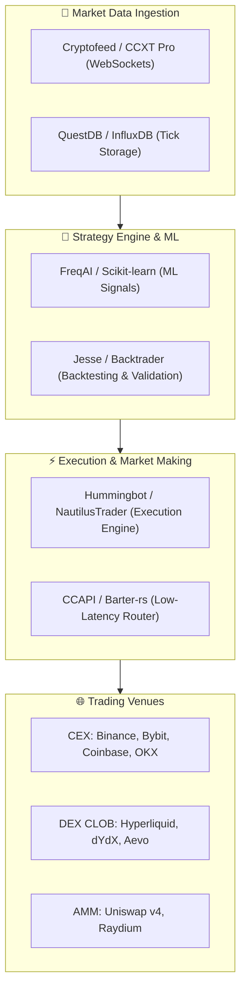

# ⚡ Awesome Automated Trading Infrastructure in Crypto 🚀

  

  
  
  
  
  
  

---

## 📖 Overview & SEO Summary 🔍

Welcome to the definitive, curated index of **Automated Trading Infrastructure in Crypto**, covering **institutional-grade SaaS execution engines**, **proprietary market-making liquidity networks**, and **high-performance open-source algorithmic trading bot frameworks**.

Whether you are a quantitative hedge fund architecting sub-millisecond high-frequency trading (HFT) pipelines in Rust, a token team maintaining decentralized exchange (DEX) liquidity, or a retail quant deploying machine-learning strategies across Binance, Bybit, OKX, Hyperliquid, and Uniswap, this guide catalogs production-ready infrastructure with verified metrics, transparent pricing, and direct GitHub repositories.

---

## 📑 Table of Contents 🧭

- [📊 Sector Overview & Market Dynamics](#-sector-overview--market-dynamics)
- [🏢 SaaS & Hosted Platforms](#-saas--hosted-platforms)
- [💻 Open-Source GitHub Projects](#-open-source-github-projects)
- [🛠️ Recommended Architecture Stacks](#️-recommended-architecture-stacks)
- [🤝 How to Contribute](#-how-to-contribute)
- [💖 Support](#-support)
- [⭐ Star History](#-star-history)
- [⚠️ Disclaimer & Risk Management](#️-disclaimer--risk-management)

---

## 📊 Sector Overview & Market Dynamics 📈

The global cryptocurrency automated trading, algorithmic execution, and market-making infrastructure sector represents an estimated market size of **$3.8 Billion to $5.5 Billion** (as part of the broader $21.5+ Billion algorithmic trading market), expanding at an annualized compound growth rate (CAGR) of **~20.5%** fueled by institutional digital asset adoption, cross-margin derivatives, and decentralized order books.

The sector exhibits **moderate fragmentation across the application and retail bot tier** (featuring dozens of specialized visual strategy designers, DCA/Grid bot tools, and local backtesting platforms), but demonstrates **strong winner-take-all concentration at the liquidity and execution layers**: top-tier algorithmic market makers (e.g., Wintermute, GSR) and dominant high-throughput exchange infrastructure protocols (e.g., Hyperliquid, Uniswap, dYdX) process over 70% of total volume and command strong self-reinforcing network effects.

---

## 🏢 SaaS & Hosted Platforms 🌐

The following table provides a breakdown of notable institutional execution suites, market-making services, and hosted algorithmic trading bot platforms. **Sorted by Company Size (Valuation / Revenue) in descending order**:

| 🏷️ Platform | 🎯 Sector Focus & Highlights | 💰 Company Size (Valuation / Revenue) | 💳 Starting Pricing | 🎁 Free Tier Limits |
| :--- | :--- | :--- | :--- | :--- |
| **[Hyperliquid](https://hyperliquid.xyz/)** | Fully on-chain L1 perpetual & spot CLOB exchange with sub-second finality and native MM APIs | **~$12.0B FDV / Valuation** ($1B+ daily volume) | **0.010% Maker / 0.035% Taker**; $0 gas/execution platform fees for native API orders | **Free forever API trading access** with up to 1,200 requests/minute, zero platform subscription fees, and free testnet paper-trading environment with unlimited test faucet funds |
| **[Wintermute](https://www.wintermute.com/)** | Leading algorithmic market maker and programmatic liquidity provider across 50+ CEX & DEX venues | **~$2.0B Valuation** ($300B+ annual volume, $1B+ peak revenue) | **0.05% - 0.15% average spread margin** on programmatic liquidity; $50,000 min credit/trading line | **30-day sandbox pilot testing** via RFQ/FIX API with zero platform integration fees for accredited institutional counterparties |
| **[Uniswap Labs](https://uniswap.org/)** | Premier decentralized exchange protocol with automated market maker (AMM) pools and v4 custom hooks | **$1.66B Valuation** (Series B) / **~$7.0B FDV** | **0.15% - 0.25% interface fee** on select web/API swaps (0.01% - 1.0% pool swap fee for LPs); $0 protocol licensing fees | **Free forever direct smart contract SDK/RPC routing** with zero interface fees for major token pairs/stablecoins and unlimited programmatic contract calls |
| **[dYdX](https://dydx.exchange/)** | Decentralized derivatives exchange built on standalone Cosmos SDK app-chain with institutional APIs | **$1.50B Valuation** (Series C) / **~$1.2B FDV** | **0.020% Maker / 0.050% Taker** starting tier (scales down to 0% maker / 0.015% taker with volume) | **Free forever API access** with 100 requests per 10-second window, zero account maintenance fees, and free perpetual testnet sandbox |
| **[GSR Markets](https://www.gsr.io/)** | Global institutional liquidity provider, algorithmic market maker, and OTC execution provider | **~$1.50B Valuation** ($150M+ annual revenue) | **0.02% - 0.08% spread cost** on programmatic quotes; $100,000 min onboarding portfolio balance | **14-day simulated market data feed & RFQ testnet access** with no onboarding or recurring licensing fee |
| **[Talos](https://www.talos.com/)** | Premier institutional digital asset trading SaaS with smart order routing (SOR) and FIX/REST APIs | **$1.25B Valuation** (Series B) | **$2,500/month base platform license fee** + 0.5 to 1.5 bps on executed volume | **30-day proof-of-concept institutional sandbox** with full API connectivity, simulated execution feeds, and zero upfront onboarding fee |
| **[GMX](https://gmx.io/)** | Decentralized spot and perpetual exchange on Arbitrum and Avalanche with zero price impact multi-asset pools | **~$450M FDV** ($100B+ cumulative volume) | **0.05% - 0.07% position open/close fee** + dynamic hourly borrow fee (~0.001% - 0.002%/hr) | **Free forever REST & WebSocket market data indexing APIs** (rate limit 60 req/min) with unlimited Arbitrum/Avalanche testnet paper trading |
| **[Aevo](https://aevo.xyz/)** | High-performance decentralized options and perpetuals exchange built on an Ethereum OP Stack rollup | **~$350M FDV** ($30B+ traded volume) | **0.020% Maker / 0.050% Taker** on perpetual futures (0.030% on crypto options contracts) | **Free forever REST/WebSocket API credentials** with 20 req/sec rate limit, zero platform subscription fee, and unlimited testnet trading faucet |
| **[Flowdesk](https://flowdesk.co/)** | Full-service digital asset market making technology firm offering NFMM (Market Making as a Service) | **$250M Valuation** (Series B) | **$3,500/month flat NFMM software subscription** + variable trading spread | **30-day testnet liquidity sandbox integration** with $0 setup fee for qualifying token issuers and crypto funds |
| **[Orderly Network](https://orderly.network/)** | Omnichain shared order book infrastructure protocol providing unified liquidity across EVM and NEAR | **$200M Valuation** (Series A) | **0.000% Maker / 0.030% Taker** broker base fee with 40-60% broker revenue share rebating | **Free forever developer tier** with up to 50 req/sec WebSocket streams, free testnet execution API, and zero SDK license fees |
| **[Vertex Protocol](https://vertexprotocol.com/)** | Cross-margin order book DEX on Arbitrum, Sei, and Blast unifying spot, perpetuals, and integrated money markets | **$180M FDV** ($50B+ cumulative volume) | **0.000% Maker / 0.020% Taker** spot fees (0.030% taker perps) with negative maker rebates on select pairs | **Free forever API connectivity** with up to 60 req/sec WebSocket/REST, zero gas execution engine, and unlimited paper-trading testnet |
| **[3Commas](https://3commas.io/)** | Leading retail & pro crypto bot management SaaS with DCA, Grid, SmartTrade, and Signal automation | **~$100M Valuation** (Series B) | **$4.00/month** (billed annually at $48/yr) or $5.00/mo for Starter Plan ($39/mo for Pro Plan) | **Free forever plan** with 1 active DCA bot, 1 active Grid bot, unlimited manual SmartTrade orders, and 1 connected exchange account |
| **[Cryptohopper](https://www.cryptohopper.com/)** | Cloud-based automated crypto trading platform with visual strategy designer, backtesting, and market maker bots | **~$60M Valuation** (700K+ registered traders) | **$24.16/month** (billed annually at $289.92/yr) or $29.00/mo for Explorer Plan | **3-day free trial** of Hero tier (500 open positions, AI strategy designer), followed by **Pioneer Free plan** with 20 open positions and portfolio tracking forever |
| **[Bitsgap](https://bitsgap.com/)** | All-in-one crypto trading SaaS with automated Grid bots, DCA futures bots, and cross-exchange arbitrage | **~$25M Valuation / Revenue** ($300B+ volume processed) | **$23.00/month** (billed annually at $276/yr) or $29.00/mo for Basic Plan | **7-day full-featured free trial** of Pro Plan with 15 active bots and unlimited lifetime access to the Demo paper-trading simulator |
| **[Coinrule](https://coinrule.com/)** | Rule-based "If-This-Then-That" automated trading platform connecting to top global crypto exchanges | **~$20M Valuation** (Y Combinator S19 / Seed) | **$29.99/month** (billed annually at $359.88/yr) or $39.99/mo for Hobbyist Plan | **Free forever plan** with 2 live active trading rules, 2 demo rules, 1 connected exchange, and up to $3,000 monthly trading volume |

---

## 💻 Open-Source GitHub Projects 🛠️

The open-source ecosystem provides non-custodial execution frameworks, low-latency market-making daemons, and quant backtesting suites. 

**Sorted by GitHub_Stars in descending order** (all Stars_Badges link directly to the repository's stargazers page):

---

### 1. [Freqtrade](https://github.com/freqtrade/freqtrade) 
- **Language / License**: Python 🐍 | GPL-3.0
- **Key Highlights**: The most popular open-source crypto algorithmic trading bot in the world. Features built-in Web UI, Telegram control daemon, Hyperopt parameter optimization via Bayesian search, and integration with 100+ exchanges through CCXT. Includes **FreqAI**, allowing quant traders to train and deploy machine learning models (LightGBM, XGBoost, CatBoost, neural networks, and reinforcement learning via stable-baselines3) with automatic background retraining.

---

### 2. [vn.py](https://github.com/vnpy/vnpy) 
- **Language / License**: Python / C++ 🐍 | MIT
- **Key Highlights**: Institutional-grade quantitative trading framework developed for professional trading desks. Features standardized gateway architectures connecting crypto exchanges (Binance, OKX, Bybit) as well as traditional derivatives exchanges (CTP). Provides an event-driven engine, native GUI management suite, paper-trading simulated matching, and portfolio risk management modules.

---

### 3. [CCXT](https://github.com/ccxt/ccxt) 
- **Language / License**: JavaScript / TypeScript / Python / PHP / C# / Go / Rust 🌐 | MIT
- **Key Highlights**: The universal standard multi-exchange API connector library supporting over 100 cryptocurrency exchanges. Offers 56+ unified REST trade/market methods and 18+ real-time WebSocket `watch*` streaming methods. Ships with automatic request rate-limiting, failover reconnection, and unified error classes—serving as the foundational connectivity backbone for Freqtrade, Hummingbot, and countless commercial quant trading firms.

---

### 4. [NautilusTrader](https://github.com/nautechsystems/nautilus_trader) 
- **Language / License**: Rust & Python 🦀🐍 | LGPL-3.0
- **Key Highlights**: High-performance, production-grade algorithmic trading platform built with a high-throughput Rust core and Python ergonomic API. Engineered to eliminate backtest-to-live execution divergence by executing the exact same event-driven strategy code in historical tick-level simulations and live crypto execution (Binance, Bybit, Kraken). Features nanosecond timestamps, custom order books, and advanced risk limiters.

---

### 5. [Backtrader](https://github.com/mementum/backtrader) 
- **Language / License**: Python 🐍 | GPL-3.0
- **Key Highlights**: Veteran Python backtesting and live trading library designed for modularity and rapid strategy iteration. Supports multi-timeframe analysis, customizable indicators, commission schemes, slippage modeling, and PyData integrations (Pandas, Matplotlib). Extensible with community-maintained live crypto exchange drivers (CCXT, Binance).

---

### 6. [Lean (QuantConnect)](https://github.com/QuantConnect/Lean) 
- **Language / License**: C# & Python ⚡ | Apache-2.0
- **Key Highlights**: Enterprise-grade algorithmic trading engine powering the QuantConnect platform. Features native support for equities, FX, futures, options, and cryptocurrency markets (Binance, Coinbase, Kraken, Bitfinex). Provides institutional-grade backtesting with tick, second, and minute resolution data, realistic order fill modeling, and multi-asset portfolio rebalancing.

---

### 7. [Hummingbot](https://github.com/hummingbot/hummingbot) 
- **Language / License**: Python & Cython 🐍 | Apache-2.0
- **Key Highlights**: Institutional open-source crypto market-making and liquidity automation framework operating in production since 2019. Maintains 50+ centralized (CEX) connectors and decentralized (DEX Gateway for Uniswap, Raydium, Jupiter). Features pure market making, cross-exchange arbitrage, order book spread maintenance, multi-bot orchestration via Docker, and the Condor AI harness for LLM-driven trading agents.

---

### 8. [TA-Lib Python](https://github.com/mrjbq7/ta-lib) 
- **Language / License**: C & Python 📊 | BSD
- **Key Highlights**: High-speed Python wrapper for TA-Lib (Technical Analysis Library). Essential mathematical engine used across crypto trading bots for calculating 150+ quantitative indicators including RSI, MACD, Bollinger Bands, Stochastic, ATR, and automated candlestick pattern recognition with zero computational overhead.

---

### 9. [Gekko](https://github.com/askmike/gekko) 
- **Language / License**: JavaScript / Node.js ☕ | MIT
- **Key Highlights**: Pioneering open-source cryptocurrency trading bot and backtesting platform with a clean web GUI and CLI. While legacy, Gekko established foundational architectural patterns for web-managed algorithmic bot architectures, automated CLI backtesting sweeps, and multi-exchange data collection across Bitcoin and Altcoins.

---

### 10. [Jesse](https://github.com/jesse-ai/jesse) 
- **Language / License**: Python 🐍 | MIT
- **Key Highlights**: Modern, developer-first quantitative crypto trading framework emphasizing clean strategy syntax and hyper-realistic backtesting. Built-in position sizing, realistic dynamic fees, partial fills, and slippage simulation prevent lookahead bias without convoluted boilerplate. Features native multi-timeframe candle routing and an intuitive strategy API.

---

### 11. [OctoBot](https://github.com/Drakkar-Software/OctoBot) 
- **Language / License**: Python 🐍 | GPL-3.0
- **Key Highlights**: Modular crypto trading robot supporting automated grid trading, DCA, AI predictions, and market making via the specialized `OctoBot-Market-Making` suite. Connects to 15+ exchanges (Binance, KuCoin, OKX, Hyperliquid), features paper trading simulation, Telegram/Discord remote management, and an accessible Web dashboard.

---

### 12. [Superalgos](https://github.com/superalgos/superalgos) 
- **Language / License**: JavaScript / Node.js 🌐 | Apache-2.0
- **Key Highlights**: Comprehensive algorithmic trading platform featuring a visual node-based strategy designer, data mining pipelines, machine learning integration, and distributed multi-server execution. Enables visual strategy creation, automated live execution across crypto exchanges, and collaborative crowdsourced quant intelligence.

---

### 13. [Binance Trading Bot](https://github.com/chrisleekr/binance-trading-bot) 
- **Language / License**: JavaScript / Node.js ☕ | MIT
- **Key Highlights**: Automated spot trading bot specifically tailored for Binance and Binance US. Includes a rich responsive frontend dashboard, real-time WebSocket order tracking, buy/sell signal monitoring, customizable stop-loss/take-profit risk settings, and Docker containerized deployment.

---

### 14. [Binance Connector Python](https://github.com/binance/binance-connector-python) 
- **Language / License**: Python 🐍 | MIT
- **Key Highlights**: Official lightweight connector for Binance Public Spot and Margin REST and WebSocket APIs. Provides authenticated RSA/Ed25519 signing, zero unnecessary dependencies, and complete testnet compatibility for developers constructing bespoke high-throughput execution engines.

---

### 15. [Cryptofeed](https://github.com/bmoscon/cryptofeed) 
- **Language / License**: Python 🐍 | MIT
- **Key Highlights**: Standardized, asynchronous cryptocurrency data feed handler streaming real-time normalized market data (L2/L3 order books, trades, ticker, funding rates, open interest) from 30+ crypto exchanges over WebSocket. Integrates with Redis, Kafka, InfluxDB, QuestDB, and Postgres for institutional quant research.

---

### 16. [Barter-rs](https://github.com/barter-rs/barter-rs) 
- **Language / License**: Rust 🦀 | MIT
- **Key Highlights**: Open-source Rust framework engineered for ultra-fast, event-driven live trading and backtesting across multiple crypto venues. Features high-performance market data normalization, modular execution engines, risk controllers, and sub-millisecond async order routing.

---

### 17. [NinjaBot](https://github.com/rodrigo-brito/ninjabot) 
- **Language / License**: Go (Golang) 🐹 | MIT
- **Key Highlights**: Fast, lightweight cryptocurrency algorithmic trading bot framework in Go. Features clean idiomatic architecture, fast backtesting engine, paper trading simulation, Telegram notifications, and native Binance connector with low memory consumption and concurrent goroutines.

---

### 18. [Kelp](https://github.com/stellar/kelp) 
- **Language / License**: Go (Golang) 🐹 | Apache-2.0
- **Key Highlights**: Free, customizable, open-source market-making bot developed by the Stellar Development Foundation. Implements automated spread strategies, balanced order book placement, and centralized exchange connectors (Binance, Kraken, Poloniex) as well as Stellar DEX liquidity provision.

---

### 19. [ADAMANT Tradebot](https://github.com/adamant-im/adamant-tradebot) 
- **Language / License**: JavaScript / Node.js ☕ | GPL-3.0
- **Key Highlights**: Free, self-hosted market-making and liquidity management bot tailored for token issuers and crypto communities. Operates without exposing API keys to external servers, providing dynamic order book building, spread maintenance, reference price arbitrage, and secure management via decentralized messenger commands.

---

### 20. [OpenSQT Market Maker](https://github.com/dennisyang1986/opensqt_market_maker) 
- **Language / License**: Go (Golang) 🐹 | Open Source
- **Key Highlights**: High-concurrency, millisecond-latency crypto market maker built in Go. Employs WebSocket-driven order-flow handling, intelligent smart grid strategies with a "Super Slot" order management system, volume-anomaly risk checks, and local/exchange state reconciliation across Binance, Bitget, and Gate.io.

---

### 21. [CCAPI](https://github.com/crypto-chassis/ccapi) 
- **Language / License**: C++ ⚡ | Apache-2.0
- **Key Highlights**: Header-only, ultra-low-latency C++ library for streaming market data and executing trades across 25+ cryptocurrency exchanges. Optimized for HFT trading firms needing microsecond parsing, lock-free queues, and cross-platform high-throughput order execution.

---

## 🛠️ Recommended Architecture Stacks 🧱

For institutions and quant developers architecting custom trading infrastructure, combining specialized open-source layers yields battle-tested reliability:

---

## 🤝 How to Contribute 💡

Contributions are warmly welcomed! Help keep this directory accurate, up-to-date, and comprehensive:

1. **Fork the repository** to your GitHub account.
2. **Add or update entries** in `README.md` following the existing format.
   - For SaaS products: Include specific starting tier pricing and specific free tier limits in tabular form.
   - For Open-Source repositories: Include language, license, key features, and the standard Stars_Badge linked to stargazers.
3. **Validate links and data** to ensure factual accuracy.
4. **Submit a Pull Request (PR)** with a clear description of the project and its relevance to crypto automated trading.

For more awesome curated resources, visit [Awesome-Awesome-Awesome](https://github.com/ishandutta2007/Awesome-Awesome-Awesome)!

---

## 💖 Support & Community 🙏

If this curated repository saved you research time, assisted your quant system development, or provided valuable market intelligence:

- ⭐ **Star this repository** to help other quant developers and market makers discover it!
- 🍴 **Fork it** to create your own customized infrastructure reference.
- 📢 **Share it** on Twitter/X, LinkedIn, Discord, and Telegram with fellow crypto developers.
- ☕ **Sponsor & Buy a Coffee**: If you'd like to support ongoing maintenance and new tools indexing, please consider sponsoring via the [GitHub Sponsor Dashboard](https://github.com/sponsors/ishandutta2007). Thank you for your support! 🚀

---

## ⭐ Star History

---

## ⚠️ Disclaimer & Risk Management 🛡️

- **Community Curated**: This repository is a community-maintained index for informational and educational purposes only. Inclusion does not constitute financial, investment, or legal advice.
- **Capital Risk**: Automated algorithmic trading systems place live capital at risk. Ensure robust risk controls—including circuit breakers, max drawdown auto-halts, balance sanity checks, API key IP whitelisting, and credential encryption.
- **Live vs. Backtest Divergence**: Always validate strategies in live paper trading or testnets prior to committing production capital. Historical performance and simulated backtest results are not indicative of future market returns.
- **Key Self-Custody**: Open-source tools like Hummingbot, Freqtrade, and NautilusTrader maintain API keys directly on your private infrastructure. You are solely responsible for server security, access permissions, and continuous operational maintenance.
